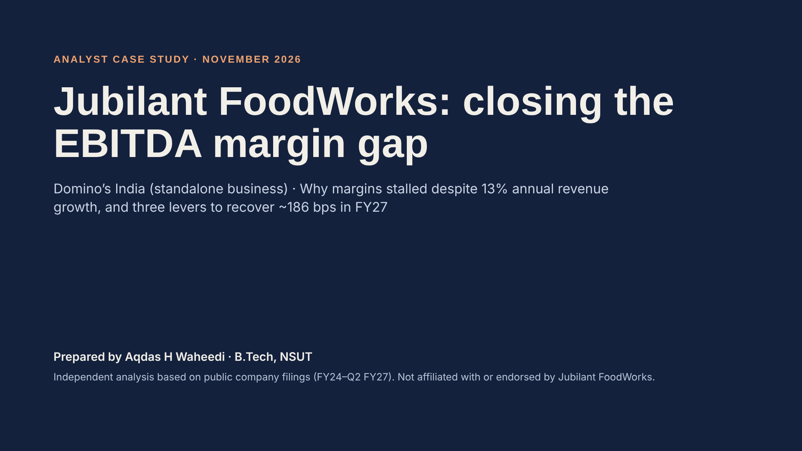
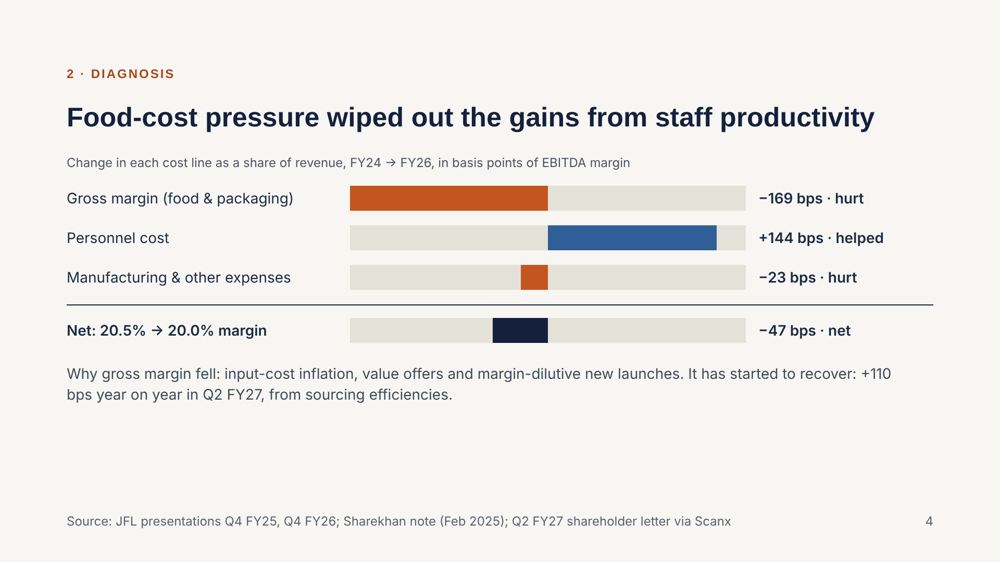
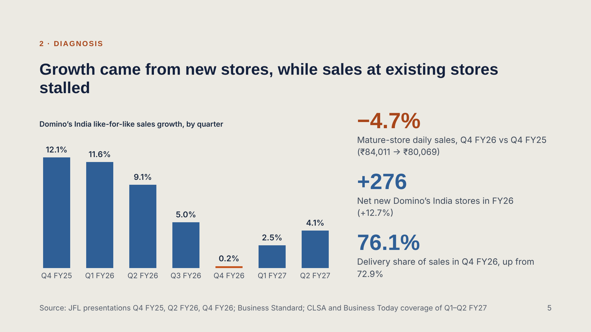
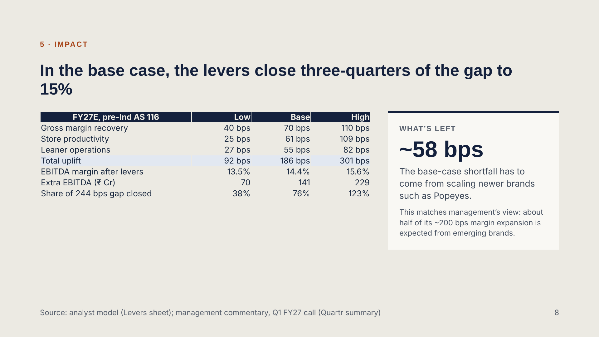

# Jubilant FoodWorks: EBITDA Improvement Case

**Why did Domino's India grow revenue 13% a year but not its margin, and what can fix it?**

A consulting-style case study on Jubilant FoodWorks Ltd. (JFL), the master franchisee of Domino's Pizza in India. It covers the standalone (India) business. I built a 3-year financial model from the company's public filings, diagnosed what held back EBITDA margin, and sized three improvement levers against management's target of a 15% pre-Ind AS 116 EBITDA margin.



## Key findings

| | |
|---|---|
| **Growth without margin** | Revenue grew at a **13.3% CAGR** (₹5,342 Cr → ₹6,856 Cr, FY24 → FY26), but reported EBITDA margin fell **47 bps** (20.5% → 20.0%). |
| **Root cause 1: food costs** | Gross margin fell **169 bps** (76.4% → 74.7%), wiping out **144 bps** of staff-cost operating leverage. |
| **Root cause 2: store productivity** | Same-store (LFL) growth slowed every quarter of FY26, from 11.6% to **0.2%**. Mature-store daily sales fell **4.7%** YoY while the network grew ~13% (+276 stores). |
| **The gap** | Pre-Ind AS 116 EBITDA margin was 12.6% in FY26 against a 15% target: a **244 bps gap (~₹167 Cr)**. |
| **The fix** | Three levers add **~186 bps (~₹141 Cr EBITDA)** in the base case, closing **76% of the gap**. The rest has to come from scaling emerging brands such as Popeyes. |

### Where the margin went (FY24 → FY26)


### Same-store sales stalled as the network expanded


### Lever impact: Low / Base / High scenarios


## The three levers (base case, FY27E)

| Lever | What it involves | Margin uplift | EBITDA |
|---|---|---|---|
| 1. Recover gross margin | Sourcing contracts, wastage control, margin-accretive product mix | +70 bps | ≈ ₹53 Cr |
| 2. Lift store productivity | Disciplined openings, cannibalisation checks, dine-in and app-reorder revival | +61 bps | ≈ ₹46 Cr |
| 3. Run stores leaner | Rider batching and route optimisation, energy efficiency, demand-based rostering | +55 bps | ≈ ₹42 Cr |
| **Total** | | **+186 bps** | **≈ ₹141 Cr** |

The deck includes a 12-month roadmap (quick wins → pilots → scale) and a monthly KPI dashboard.

## Repository contents

```
├── model/
│   └── JFL_EBITDA_Improvement_Model.xlsx   # Financial model (formula-driven, sourced)
├── deck/
│   └── JFL_EBITDA_Improvement_Case.pdf     # 10-slide consulting deck
├── images/                                 # Slide previews used in this README
└── README.md
```

### The Excel model

| Sheet | What it does |
|---|---|
| `Cover` | Objective, sheet guide, colour legend, data notes |
| `Historical_PL` | FY24–FY26 standalone P&L, common-size analysis, YoY growth, reconciliation checks (EBITDA and PBT tie to reported figures) |
| `Margin_Bridge` | FY24 → FY26 EBITDA margin bridge by cost line (bps), pre-Ind AS view, gap to the 15% target |
| `Operating_KPIs` | Quarterly LFL growth, mature-store ADS, delivery mix, store count |
| `Levers` | Three levers with a **Low / Base / High scenario switch** (cell `B4`), ₹ and bps impact, share of the gap closed |

Conventions: **blue** = sourced input (hover a cell for its citation), **black** = formula, **green** = cross-sheet link, **yellow** = editable assumption. All 153 formulas calculate without errors.

## Methodology

1. **Data:** standalone P&L for FY24–FY26 from JFL's quarterly earnings presentations, plus quarterly operating KPIs from company presentations and results coverage.
2. **Diagnosis:** common-size analysis (each cost line as % of revenue), then a margin bridge isolating each line's contribution to the change in EBITDA margin.
3. **Gap sizing:** FY26 pre-Ind AS 116 EBITDA margin vs management's stated 15% target.
4. **Lever sizing:**
   - *Gross margin:* direct bps recovery, anchored to the company's own +110 bps gross-margin gain in Q2 FY27.
   - *Store productivity:* operating leverage. Uplift = fixed-cost share of revenue × g ÷ (1 + g), where g = extra same-store growth.
   - *Opex efficiency:* % saving applied to the personnel + other operating cost pool (~55% of revenue).
5. **Scenarios:** Low / Base / High on every driver, with ₹ impact at FY27E revenue (FY26 + 11%).

### Key assumptions

- FY27 revenue growth of 11%, in line with H1 FY27 standalone growth.
- ~50% of store operating cost is fixed in the short run (rent, base staffing, utilities). The sensitivity is in the model.
- Levers are modelled independently, with no overlap.
- FY25 figures are as restated in the FY26 presentation (discontinued operations); FY24 is as originally reported (~0.6% basis difference, with no effect on the trends).

## Sources

- Jubilant FoodWorks: Earnings Presentation Q4 & FY25 (May 2025), standalone P&L
- Jubilant FoodWorks: Earnings Presentation Q2 FY26 (Nov 2025)
- Jubilant FoodWorks: Earnings Presentation Q4 & FY26 (May 2026), standalone P&L and operating metrics
- Earnings-call summaries (Quartr): Q3 FY26 (15% margin target), Q1 FY27 (~200 bps margin-expansion outlook)
- Q1–Q2 FY27 results coverage: Business Standard, CLSA (via Free Press Journal), Business Today, Scanx

Each sourced number in the Excel model carries a cell comment with its specific source and link.

## Skills demonstrated

Financial statement analysis · Margin bridge and driver analysis · Scenario modelling in Excel · Ind AS 116 (pre/post lease) adjustments · Structured problem solving (Situation–Complication–Resolution) · Consulting-style storytelling and implementation roadmaps

---

*Independent analysis built from publicly available information for learning and portfolio purposes. Not investment advice, and not affiliated with or endorsed by Jubilant FoodWorks Ltd.*

**Author:** Aqdas H Waheedi, B.Tech (Instrumentation & Control), Netaji Subhas University of Technology · [LinkedIn](https://www.linkedin.com/in/aqdas-h-waheedi-02567a375/) · [GitHub](https://github.com/Aqdas999)
